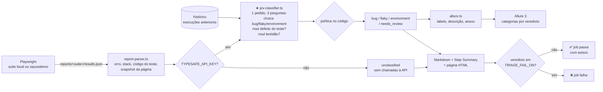

# Playwright + Jev: triagem automática de testes falhados

Projeto pequeno, feito para aprender, que junta suites **Playwright + TypeScript** com o **Jev**, o modelo System One da [TypeSafe](https://docs.typesafe.ai). Depois de cada execução, o Jev analisa cada teste falhado e responde a três perguntas no mesmo pedido:

- **qual a causa?** `bug`, `flaky` ou `environment`, com a probabilidade de cada opção (pergunta `choice`);
- **o defeito está no código do teste e não na app?** (pergunta `noul`);
- **a falha deve-se a lentidão?** (pergunta `noul`).

O pipeline só falha quando existe um **bug** real na app.

Relatórios publicados: **https://brlorena.github.io/jev_test/** (suite local) e **https://brlorena.github.io/jev_test/saucedemo/**

## As duas suites

### `local`: uma mini loja em `app/`

Servida pelo `webServer` do Playwright, sem depender de sites externos. Tem 8 testes, 3 dos quais falham de propósito:

| Teste | Tipo de falha | Como é provocada |
|---|---|---|
| `desconto de 10% é aplicado ao total` | 🐞 bug | A app aplica o desconto duas vezes (`app/public/index.html`) |
| `o relatório carrega em menos de 1 segundo` | 🎲 flaky | `/api/report` atrasa entre 0 e `FLAKY_MAX_DELAY_MS`, mas o teste só espera 1 s |
| `o stock dos produtos é apresentado` | 🔌 environment | `/api/inventory` devolve 503 quando `FAKE_ENV_DOWN=1` |

### `saucedemo`: https://www.saucedemo.com

Um site público feito para praticar automação. Cada utilizador de demonstração tem defeitos diferentes, todos confirmados ao explorar o site. Tem 13 testes, 9 dos quais falham de propósito:

| Teste | Utilizador | Falha esperada |
|---|---|---|
| login válido, utilizador bloqueado, password errada, checkout com total $28.06 | standard / locked_out | ✅ passam |
| os produtos têm imagens diferentes | problem_user | 🐞 todas as imagens são iguais |
| clicar num produto abre esse produto | problem_user | 🐞 o Backpack abre o Fleece Jacket |
| o checkout aceita nome e apelido | problem_user | 🐞 o "Last Name" escreve no "First Name" |
| ordenar por preço | error_user | 🐞 alerta "Sorting is broken!" e a lista não muda |
| remover do carrinho atualiza o contador | error_user | 🐞 o botão "Remove" não faz nada |
| o preço da lista é igual ao do detalhe | visual_user | 🐞 os preços da lista são aleatórios |
| checkout completo dentro de 3 s | performance_glitch_user | 🐢 funciona, mas demora cerca de 6 s |
| adicionar o backpack ao carrinho | standard_user | 🧪 **defeito do teste**: seletor errado de propósito |
| o inventário carrega | standard_user | 🔌 com `SAUCE_ENV_DOWN=1` a rede é cortada |

## Onde o Jev entra no fluxo



O ficheiro mais importante para aprender é [`triage/jev-classifier.ts`](triage/jev-classifier.ts), que está comentado passo a passo:

1. **As perguntas** são três, enviadas no mesmo pedido. Correm em paralelo sobre o mesmo state e não veem as respostas umas das outras ([fan-out](https://docs.typesafe.ai/patterns/fan-out)). A latência quase não muda; só sobem alguns tokens.
   - `category` é uma `choice`. Cada opção é descrita com `what`, `signals` e `not_for`, porque as categorias confundem-se com facilidade.
   - `test_code_defect` e `slowness` são `noul`. Uma `noul` devolve só a probabilidade de "sim" e não tem `confidence`: um valor perto de 0.5 significa "não sei". São `noul` e não opções extra da `choice` porque podem ser verdadeiras ao mesmo tempo que a categoria. Um bug no teste continua a ser um "bug".
2. **O state** contém só factos observados: erro, stack, histórico de execuções, **código do teste**, **lista de `data-test` da página** e **snapshot da página** no momento da falha.
3. **A chamada** é `client.systemOne({ state, questions })`, e as respostas vêm tipadas.
4. **A política fica no nosso código:**
   - se `confidence < TRIAGE_CONFIDENCE_THRESHOLD`, o veredicto é `needs_review`;
   - se o veredicto for `bug` e `test_code_defect ≥ TRIAGE_TEST_DEFECT_THRESHOLD`, também é `needs_review`, para um teste mal escrito não bloquear o pipeline como se fosse um bug da app;
   - `slowness` é só informativa: aparece nos relatórios e como tag no Allure.

## O que aprendemos sobre o state

Em todos os casos abaixo, a melhoria veio de dar **mais evidência** ao Jev, não de mudar a pergunta.

### 1. O histórico separa um bug de um teste flaky

Os testes correm sem retries. Numa única execução, o teste flaky falha assim: "esperei 1 s e o texto nunca apareceu", o que parece um bug.

| Teste flaky | State | Resultado |
|---|---|---|
| sem histórico | só o erro desta execução | 🐞 bug (95%) |
| com histórico | erro + `❌❌❌❌❌✅✅✅✅` | 🎲 flaky (98%) |

O histórico está em [`triage/history.ts`](triage/history.ts) e guarda até 20 execuções por teste, incluindo as que passaram. O Jev vê só as execuções **anteriores**.

### 2. Para julgar o teste, o Jev precisa de ver o teste e a página

O seletor errado (`add-to-cart-backpack` em vez de `add-to-cart-sauce-labs-backpack`) dá um timeout. Só com o erro, não se sabe se o botão falta na página (bug da app) ou se o seletor está errado (bug do teste).

| State | P(defeito do teste) |
|---|---|
| erro + código do teste | 0.34 |
| + `data-test` presentes na página + snapshot | **0.92** |

O caso contrário também funciona. No `problem_user`, o teste preenche o apelido e a app responde "Last Name is required". Parece um teste mal escrito, mas o Jev deu **0.29**: o defeito é da app.

- O código do teste é enviado **sem comentários**. Os comentários dos nossos testes dizem "BUG" ou "DEFEITO DO TESTE", e enviá-los seria dar a resposta ao Jev.
- A lista de `data-test` vem de uma fixture automática em [`tests/saucedemo/support.ts`](tests/saucedemo/support.ts). O snapshot vem do anexo `error-context` que o Playwright já cria para cada falha.

### 3. A lentidão é uma dimensão própria

O `performance_glitch_user` funciona, mas é lento. Com só três categorias, o Jev teria de o encaixar à força em bug ou flaky. A `noul` `slowness` deu **0.94** nesse teste e ficou baixa em todos os outros.

## Allure 3

A triagem acrescenta a análise do Jev aos resultados do [`allure-playwright`](https://allurereport.org/docs/playwright/) ([`triage/allure.ts`](triage/allure.ts)):

- **Labels**: `jev_verdict`, `jev_confidence`, `jev_test_code_defect` e `jev_slowness`.
- **Tags**: `jev:<veredicto>`, mais `jev:test-code-defect` e `jev:slow` quando passam o limiar.
- **Categorias** em [`allurerc.mjs`](allurerc.mjs): uma por veredicto (🐞 Bug, 🎲 Flaky, 🔌 Environment, 👀 Needs review).
- **Descrição** com o veredicto, as probabilidades e as duas `noul`.
- **Anexo "Jev triage"** com o state exato enviado ao Jev e a resposta. É a melhor forma de perceber cada decisão.

O Allure guarda também o seu próprio histórico, para os trends e para a deteção de flaky do próprio Allure.

## Correr localmente

Requisitos: Node 22.15 ou superior (recomendado: 24 LTS).

```bash
npm ci
npx playwright install chromium
cp .env.example .env        # põe a TYPESAFE_API_KEY no .env (ou deixa vazia para o fallback)
```

| Script | O que faz |
|---|---|
| `npm test` / `npm run test:saucedemo` | Corre a suite (apenas Chromium) |
| `npm run triage` / `npm run triage:saucedemo` | Triagem sobre o último relatório da suite |
| `npm run test:triage` / `npm run test:triage:saucedemo` | Testes e triagem, mesmo que haja testes a falhar |
| `npm run allure` / `npm run allure:saucedemo` | Gera o relatório Allure 3 (depois da triagem) |
| `npm run allure:open` | Serve o Allure da suite local (`SUITE=saucedemo npm run allure:open` para a outra) |
| `npm run typecheck` | `tsc` sem gerar ficheiros |
| `npm start` | Arranca a app local em http://localhost:3000 |

Tudo o que cada suite gera fica em `reports/<suite>/`: `results.json`, `playwright-report/`, `allure-results/`, `allure-report/` e `triage/` (Markdown, HTML e JSON). Os históricos ficam em `.history/<suite>/`.

**Sem chave**, todas as falhas ficam `unclassified` e o exit code é 0. **Com chave**, o exit code é 1 se houver falhas classificadas como `bug`.

### Variáveis de ambiente

| Variável | Default | Para quê |
|---|---|---|
| `TYPESAFE_API_KEY` | – | Chave da API. Sem ela, a triagem corre em fallback |
| `TYPESAFE_DEFAULT_MODEL` | `jev-latest` | Modelo. Fixa uma versão (ex.: `jev-1.13.0`) depois de afinares os limiares |
| `SUITE` | `local` | Suite que a triagem e o Allure processam (`local` ou `saucedemo`) |
| `TRIAGE_CONFIDENCE_THRESHOLD` | `0.6` | Abaixo deste valor, a falha fica `needs_review` |
| `TRIAGE_TEST_DEFECT_THRESHOLD` | `0.7` | `bug` com P(defeito do teste) acima disto passa a `needs_review` |
| `TRIAGE_SLOWNESS_THRESHOLD` | `0.7` | A partir daqui, a lentidão vira tag `jev:slow` no Allure |
| `TRIAGE_FAIL_ON` | `bug` | Veredictos que fazem o job falhar, separados por vírgula |
| `TRIAGE_HISTORY_SIZE` | `20` | Quantas execuções guardar por teste |
| `FAKE_ENV_DOWN` | – | `1`: na app local, `/api/inventory` devolve 503 |
| `FLAKY_MAX_DELAY_MS` | `2000` | Atraso máximo de `/api/report` na app local |
| `SAUCE_ENV_DOWN` | – | `1`: no saucedemo, o teste "o inventário carrega" corta a rede |

## Pipeline (GitHub Actions)

O workflow [`.github/workflows/e2e-triage.yml`](.github/workflows/e2e-triage.yml) corre em `push` e `pull_request`, com uma **matriz** de duas suites (`local` e `saucedemo`). Uma suite a falhar não cancela a outra.

Em cada suite:

1. Instala as dependências e o Chromium.
2. Corre os testes com `continue-on-error`: os testes vermelhos não decidem sozinhos o resultado do job.
3. Descarrega do GitHub Pages o histórico da triagem e o do Allure.
4. Corre a triagem com `if: always()`. Este passo decide o resultado: o job falha só se houver veredictos em `TRIAGE_FAIL_ON`. Os restantes aparecem como avisos no summary.
5. Gera o Allure 3, já com a análise do Jev.
6. Publica os artifacts `reports-<suite>`.

Em push para `master`, o job `deploy-pages` junta as duas suites e publica-as: `local` na raiz e `saucedemo` em `/saucedemo/`. Cada uma tem a triagem, `/allure/`, `/playwright-report/` e os históricos. A publicação acontece mesmo quando os jobs falham por causa de um bug.

> Para ativares o Pages num fork: **Settings → Pages → Build and deployment → Source: GitHub Actions**.

### Configurar o secret

1. No GitHub, abre o repositório e vai a **Settings → Secrets and variables → Actions**.
2. Em **Secrets**, clica em **New repository secret**, com nome `TYPESAFE_API_KEY` e a tua chave como valor.
3. (Opcional) Em **Variables**, cria `TRIAGE_FAIL_ON`, `TRIAGE_CONFIDENCE_THRESHOLD` ou `TRIAGE_TEST_DEFECT_THRESHOLD` para mudar as regras sem editar o workflow.

Sem o secret, o pipeline corre em fallback e passa. O mesmo acontece em pull requests vindos de forks, porque o GitHub não lhes passa secrets.

### Custos

A app local corre dentro do runner, e o saucedemo é público, por isso não há alojamento. Em repositórios públicos, o GitHub Actions é gratuito nos runners normais. O único custo é a API do Jev, cobrada por token de entrada. Cada falha usa alguns milhares de tokens, sobretudo por causa do snapshot da página.

## Estrutura

```
app/                          servidor Node (http nativo) + página HTML (suite local)
tests/local/                  testes da app local (shop, report = flaky, inventory = environment)
tests/saucedemo/              testes do saucedemo + support.ts (login e fixture data-test)
playwright.shared.ts          configuração comum: reports/<suite>/, reporters, sem retries
playwright.config.ts          suite local (webServer)
playwright.saucedemo.config.ts suite saucedemo
allurerc.mjs                  Allure 3: categorias por veredicto do Jev, histórico por suite
triage/
  config.ts           variáveis de ambiente e caminhos por suite
  report-parser.ts    lê o relatório JSON: erro, stack, código do teste, snapshot, data-test
  history.ts          histórico de execuções por teste
  jev-classifier.ts   ★ integração com o Jev (choice + 2 noul)
  allure.ts           acrescenta a análise do Jev aos resultados Allure
  markdown.ts         relatório Markdown
  html.ts             página HTML do GitHub Pages
  triage.ts           ponto de entrada + exit code
```

## Notas para aprender mais

- Os limiares (`0.6` e `0.7`) são um ponto de partida. A documentação da TypeSafe recomenda afiná-los com dados reais. Guarda os `triage-results.json` de várias execuções e compara-os com a classificação feita por uma pessoa.
- `confidence` e o valor de uma `noul` medem a incerteza do modelo. Não são uma garantia de que a resposta está certa. Ver [Confidence](https://docs.typesafe.ai/confidence) e [Noul](https://docs.typesafe.ai/primitives/noul).
- Ideias para evoluir:
  - registar no state os tempos de resposta da rede durante o teste;
  - usar uma `score` para a gravidade do bug;
  - acrescentar uma `noul` "esta falha corresponde a um problema conhecido?", com a lista de problemas no state.
