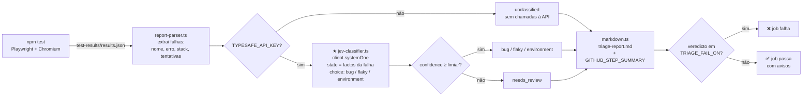

# Playwright + Jev: triagem automática de testes falhados

Projeto pequeno, feito para aprender, que junta uma suite **Playwright + TypeScript** com o **Jev**, o modelo System One da [TypeSafe](https://docs.typesafe.ai). Depois de cada execução, o Jev classifica cada teste falhado como `bug`, `flaky` ou `environment` e devolve a probabilidade de cada opção. O pipeline só falha quando existe um **bug** real.

## O que o projeto demonstra

- Uma app web mínima e local (`app/`), levantada pelo `webServer` do Playwright, sem depender de sites externos.
- 8 testes. 5 passam e 3 falham de propósito:

  | Teste | Tipo de falha | Como é provocada |
  |---|---|---|
  | `desconto de 10% é aplicado ao total` | 🐞 **bug** | A app aplica o desconto duas vezes (`app/public/index.html`) |
  | `o relatório carrega em menos de 1 segundo` | 🎲 **flaky** | `/api/report` responde com um atraso aleatório entre 0 e `FLAKY_MAX_DELAY_MS`, mas o teste só espera 1 s |
  | `o stock dos produtos é apresentado` | 🔌 **environment** | `/api/inventory` devolve 503 quando `FAKE_ENV_DOWN=1` |

- Triagem com o Jev (`triage/`): lê o relatório JSON do Playwright e faz uma pergunta `choice` por falha. Se o `confidence` ficar abaixo de um limiar, a falha passa a `needs_review`.
- Relatório Markdown em `triage-output/triage-report.md`, também escrito no **GitHub Step Summary**.
- Fallback: sem `TYPESAFE_API_KEY` não há chamadas à API, tudo fica `unclassified` e o pipeline continua.

## Onde o Jev entra no fluxo



O ficheiro mais importante para aprender é [`triage/jev-classifier.ts`](triage/jev-classifier.ts), que está comentado passo a passo:

1. **A pergunta**: uma `choice` com três opções. Cada opção é descrita com `what`, `signals` e `not_for`, porque as categorias confundem-se com facilidade.
2. **O state**: só factos observados, como o título, a mensagem de erro, um excerto do stack e o resultado de cada tentativa (`passed_on_retry`, `failed_attempts`, ...). Não enviamos o rótulo `flaky` do Playwright; o Jev tem de chegar lá a partir dos factos.
3. **A chamada**: `client.systemOne({ state, questions })`. A resposta vem tipada, com `choice`, `probabilities` e `confidence`.
4. **A política fica no nosso código**: se `confidence < limiar`, o veredicto é `needs_review`. O que faz o job falhar é decidido por `TRIAGE_FAIL_ON`.

O Jev não gera texto nem explicações. Devolve uma decisão estruturada e calibrada, e o código decide o que fazer com ela.

## Correr localmente

Requisitos: Node 22.15 ou superior (recomendado: 24 LTS).

```bash
npm ci
npx playwright install chromium
cp .env.example .env        # FAKE_ENV_DOWN=1 já vem ligado
```

### Sem chave (fallback)

Deixa `TYPESAFE_API_KEY` vazio no `.env`:

```bash
npm run test:triage   # testes + triagem
npm run triage        # só a triagem sobre o último relatório
```

Todas as falhas aparecem como `unclassified` e o exit code é 0.

### Com chave

1. Cria uma chave em [console.typesafe.ai](https://console.typesafe.ai).
2. Coloca-a no `.env`:
   ```
   TYPESAFE_API_KEY=ts_...
   ```
3. Corre `npm run test:triage` e abre `triage-output/triage-report.md`.

O exit code passa a ser 1 se alguma falha for classificada como `bug`.

### Scripts

| Script | O que faz |
|---|---|
| `npm test` | Corre a suite Playwright (apenas Chromium) |
| `npm run triage` | Corre só a triagem sobre `test-results/results.json` |
| `npm run test:triage` | Corre os testes e depois a triagem, mesmo que haja testes a falhar |
| `npm run typecheck` | `tsc` sem gerar ficheiros |
| `npm start` | Arranca a app em http://localhost:3000 para a explorares à mão |

### Variáveis de ambiente

| Variável | Default | Para quê |
|---|---|---|
| `TYPESAFE_API_KEY` | – | Chave da API. Sem ela, a triagem corre em fallback |
| `TYPESAFE_DEFAULT_MODEL` | `jev-latest` | Modelo. Fixa uma versão (ex.: `jev-1.13.0`) depois de afinares o limiar |
| `TRIAGE_CONFIDENCE_THRESHOLD` | `0.6` | Abaixo deste valor, a falha fica `needs_review` |
| `TRIAGE_FAIL_ON` | `bug` | Veredictos que fazem o job falhar, separados por vírgula (ex.: `bug,needs_review`) |
| `FAKE_ENV_DOWN` | – | `1` faz `/api/inventory` devolver 503 |
| `FLAKY_MAX_DELAY_MS` | `2000` | Atraso máximo de `/api/report`. Quanto maior, mais vezes o teste flaky falha |

> O teste flaky é aleatório de propósito: há execuções em que passa à primeira e não aparece na triagem. Para o forçares a falhar com mais frequência, aumenta `FLAKY_MAX_DELAY_MS` (ex.: `3000`).

## Pipeline (GitHub Actions)

O workflow [`.github/workflows/e2e-triage.yml`](.github/workflows/e2e-triage.yml) corre em `push` e `pull_request`:

1. `npm ci` e instalação do Chromium.
2. `npm test` com `continue-on-error`: os testes vermelhos não decidem sozinhos o resultado do job.
3. `npm run triage` com `if: always()`. Este passo decide o resultado: falha só se houver veredictos em `TRIAGE_FAIL_ON`. Os restantes aparecem como avisos no summary e como anotações.
4. Publica como artifacts o `playwright-report` (HTML) e o `triage-results` (Markdown, JSON e o relatório JSON do Playwright).

### Configurar o secret

1. No GitHub, abre o repositório e vai a **Settings → Secrets and variables → Actions**.
2. Em **Secrets**, clica em **New repository secret**, com nome `TYPESAFE_API_KEY` e a tua chave como valor.
3. (Opcional) Em **Variables**, cria `TRIAGE_FAIL_ON` (ex.: `bug,needs_review`) e/ou `TRIAGE_CONFIDENCE_THRESHOLD` para mudar as regras sem editar o workflow.

Sem o secret, o pipeline corre em fallback e passa. O mesmo acontece em pull requests vindos de forks, porque o GitHub não lhes passa secrets.

### Custos

A app corre dentro do runner, por isso não há alojamento. Em repositórios públicos, o GitHub Actions é gratuito nos runners normais. O único custo é a API do Jev, cobrada por token de entrada; cada falha usa algumas centenas de tokens.

## Estrutura

```
app/            servidor Node (http nativo) + página HTML
tests/          testes Playwright (shop, report = flaky, inventory = environment)
triage/
  config.ts           variáveis de ambiente
  report-parser.ts    lê o relatório JSON do Playwright
  jev-classifier.ts   ★ integração com o Jev
  markdown.ts         relatório Markdown
  triage.ts           ponto de entrada + exit code
```

## Notas para aprender mais

- Os limiares (`0.6`) são um ponto de partida. A documentação da TypeSafe recomenda afiná-los com dados reais. Guarda os `triage-results.json` de várias execuções e compara-os com a classificação feita por uma pessoa.
- `confidence` mede o quão concentradas estão as probabilidades. Não é uma garantia de que a resposta está certa. Ver [Confidence](https://docs.typesafe.ai/confidence).
- Ideias para evoluir: incluir no state o excerto do código do teste, ou acrescentar uma pergunta `noul` ("a falha está no código do teste e não na app?") no mesmo pedido, sem custo extra de latência ([fan-out](https://docs.typesafe.ai/patterns/fan-out)).
