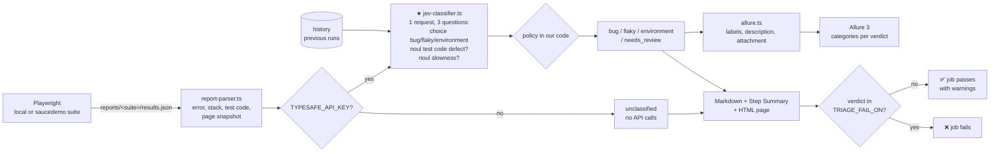

# Playwright + Jev: automatic triage of failed tests

A small project that combines **Playwright + TypeScript** test suites with **Jev**, the System One model from [TypeSafe](https://docs.typesafe.ai). After each run, Jev analyses every failed test and answers three questions in a single request:

- **What is the cause?** `bug`, `flaky` or `environment`, with a probability for each option (a `choice` question).
- **Is the defect in the test code rather than in the app?** (a `noul` question)
- **Is the failure caused by slowness?** (a `noul` question)

The pipeline only fails when there is a real **bug** in the app.

Published reports:
- **Allure report with both suites:** https://brlorena.github.io/jev_test/allure/
- **Local suite triage:** https://brlorena.github.io/jev_test/
- **Saucedemo triage:** https://brlorena.github.io/jev_test/saucedemo/

## The two suites

### `local`: a mini shop in `app/`

Served by Playwright's `webServer`, with no dependency on external sites. It has 8 tests, 3 of which fail on purpose:

| Test | Failure type | How it is triggered |
|---|---|---|
| `10% discount is applied to the total` | 🐞 bug | The app applies the discount twice (`app/public/index.html`) |
| `the report loads in under 1 second` | 🎲 flaky | `/api/report` waits a random 0 to `FLAKY_MAX_DELAY_MS`, but the test only waits 1 s |
| `product stock is displayed` | 🔌 environment | `/api/inventory` returns 503 when `FAKE_ENV_DOWN=1` |

### `saucedemo`: https://www.saucedemo.com

A public site built for practising test automation. Each demo user has different defects, all confirmed by exploring the site. It has 13 tests, 9 of which fail on purpose:

| Test | User | Expected failure |
|---|---|---|
| valid login, locked-out user, wrong password, checkout with a $28.06 total | standard / locked_out | ✅ pass |
| `products have different images` | problem_user | 🐞 all images are the same |
| `clicking a product opens that product` | problem_user | 🐞 the Backpack opens the Fleece Jacket |
| `checkout accepts first and last name` | problem_user | 🐞 typing in "Last Name" writes into "First Name" |
| `sort by price (low to high)` | error_user | 🐞 "Sorting is broken!" alert and the list does not change |
| `removing from the cart updates the counter` | error_user | 🐞 the "Remove" button does nothing |
| `list price matches the detail page price` | visual_user | 🐞 list prices are random |
| `full checkout within 3 s` | performance_glitch_user | 🐢 works, but takes about 6 s |
| `add the backpack to the cart` | standard_user | 🧪 **test code defect**: deliberately wrong selector |
| `the inventory loads` | standard_user | 🔌 with `SAUCE_ENV_DOWN=1` the network is cut off |

## Where Jev fits in the flow



The key file is [`triage/jev-classifier.ts`](triage/jev-classifier.ts), which is commented step by step:

1. **The questions**: three of them, sent in the same request. They run in parallel over the same state and do not see each other's answers ([fan-out](https://docs.typesafe.ai/patterns/fan-out)). Latency barely changes; only a few extra tokens are used.
   - `category` is a `choice`. Each option is described with `what`, `signals` and `not_for`, because the categories are easy to confuse.
   - `test_code_defect` and `slowness` are `noul`s. A `noul` returns only the probability of "yes" and has no `confidence`: a value close to 0.5 means "I don't know". They are `noul`s rather than extra `choice` options because they can be true at the same time as the category. A bug in the test is still a "bug".
2. **The state** contains only observed facts: error, stack, run history, **test code**, **the list of `data-test` attributes on the page** and a **page snapshot** at the moment of failure.
3. **The call** is `client.systemOne({ state, questions })`, and the answers come back typed.
4. **The policy lives in our code:**
   - if `confidence < TRIAGE_CONFIDENCE_THRESHOLD`, the verdict is `needs_review`;
   - if the verdict is `bug` and `test_code_defect ≥ TRIAGE_TEST_DEFECT_THRESHOLD`, it is also `needs_review`, so a badly written test does not block the pipeline as if it were an app bug;
   - `slowness` is informational only: it shows up in the reports and as a tag in Allure.

## What we learned about the state

In every case below, the improvement came from giving Jev **more evidence**, not from changing the question.

### 1. History separates a bug from a flaky test

Tests run without retries. In a single run, the flaky test fails with "waited 1 s and the text never appeared", which looks like a bug.

| Flaky test | State | Result |
|---|---|---|
| no history | only this run's error | 🐞 bug (95%) |
| with history | error + `❌❌❌❌❌✅✅✅✅` | 🎲 flaky (98%) |

History lives in [`triage/history.ts`](triage/history.ts) and stores up to 20 runs per test, including passing ones. Jev only sees **previous** runs.

### 2. To judge the test, Jev needs to see the test and the page

The wrong selector (`add-to-cart-backpack` instead of `add-to-cart-sauce-labs-backpack`) causes a timeout. From the error alone, you can't tell whether the button is missing from the page (app bug) or the selector is wrong (test bug).

| State | P(test code defect) |
|---|---|
| error + test code | 0.34 |
| + `data-test` attributes on the page + snapshot | **0.92** |

It works the other way round too. With `problem_user`, the test fills in the last name and the app replies "Last Name is required". It looks like a badly written test, but Jev returned **0.29**: the defect is in the app.

- The test code is sent **without comments**. Our test comments say "BUG" or "TEST DEFECT", and sending them would hand Jev the answer.
- The `data-test` list comes from an automatic fixture in [`tests/saucedemo/support.ts`](tests/saucedemo/support.ts). The snapshot comes from the `error-context` attachment that Playwright already creates for every failure.

### 3. Slowness is its own dimension

`performance_glitch_user` works, but it is slow. With only three categories, Jev would have to force it into bug or flaky. The `slowness` `noul` returned **0.94** for that test and stayed low for all the others.

## Allure 3

There is **a single Allure report for both suites**. Each suite is an Allure 3 [environment](https://allurereport.org/docs/environments/), which you pick from the selector at the top of the report, or choose "All" to see everything together.

- The shared Playwright config tags every result with a `suite_name` label.
- [`allurerc.mjs`](allurerc.mjs) maps that label to an environment: "App local" or "Saucedemo".
- `npm run allure` builds the report from `reports/*/allure-results`, i.e. from both suites at once.

Triage adds Jev's analysis to the [`allure-playwright`](https://allurereport.org/docs/playwright/) results ([`triage/allure.ts`](triage/allure.ts)):

- **Labels**: `jev_verdict`, `jev_confidence`, `jev_test_code_defect` and `jev_slowness`.
- **Tags**: `jev:<verdict>`, plus `jev:test-code-defect` and `jev:slow` when they cross the threshold.
- **Categories** in [`allurerc.mjs`](allurerc.mjs): one per verdict (🐞 Bug, 🎲 Flaky, 🔌 Environment, 👀 Needs review).
- **Description** with the verdict, the probabilities and both `noul`s.
- **"Jev triage" attachment** with the exact state sent to Jev and its response. This is the best way to understand each decision.

Allure also keeps its own history, for trends and for Allure's own flaky detection.

## Running locally

Requirements: Node 22.15 or later (recommended: 24 LTS).

```bash
npm ci
npx playwright install chromium
cp .env.example .env        # put your TYPESAFE_API_KEY in .env (or leave it empty for the fallback)
```

| Script | What it does |
|---|---|
| `npm test` / `npm run test:saucedemo` | Runs the suite (Chromium only) |
| `npm run triage` / `npm run triage:saucedemo` | Triages the suite's latest report |
| `npm run test:triage` / `npm run test:triage:saucedemo` | Runs tests and triage, even if tests fail |
| `npm run allure` | Builds an Allure 3 report from every suite that has results (run after triage) |
| `npm run allure:open` | Serves the Allure report in the browser |
| `npm run typecheck` | `tsc` without emitting files |
| `npm start` | Starts the local app at http://localhost:3000 |

Everything each suite produces goes to `reports/<suite>/`: `results.json`, `playwright-report/`, `allure-results/` and `triage/` (Markdown, HTML and JSON). The combined Allure report goes to `reports/allure-report/`. Triage history is stored in `.history/<suite>/` and Allure history in `.history/allure.jsonl`.

**Without a key**, every failure is `unclassified` and the exit code is 0. **With a key**, the exit code is 1 if any failure is classified as `bug`.

### Environment variables

| Variable | Default | Purpose |
|---|---|---|
| `TYPESAFE_API_KEY` | – | API key. Without it, triage runs in fallback mode |
| `TYPESAFE_DEFAULT_MODEL` | `jev-latest` | Model. Pin a version (e.g. `jev-1.13.0`) once you have tuned the thresholds |
| `SUITE` | `local` | Suite to triage (`local` or `saucedemo`) |
| `TRIAGE_CONFIDENCE_THRESHOLD` | `0.6` | Below this value, the failure becomes `needs_review` |
| `TRIAGE_TEST_DEFECT_THRESHOLD` | `0.7` | A `bug` with P(test code defect) above this becomes `needs_review` |
| `TRIAGE_SLOWNESS_THRESHOLD` | `0.7` | From this value on, slowness becomes a `jev:slow` tag in Allure |
| `TRIAGE_FAIL_ON` | `bug` | Comma-separated verdicts that fail the job |
| `TRIAGE_HISTORY_SIZE` | `20` | How many runs to keep per test |
| `FAKE_ENV_DOWN` | – | `1`: in the local app, `/api/inventory` returns 503 |
| `FLAKY_MAX_DELAY_MS` | `2000` | Maximum delay of `/api/report` in the local app |
| `SAUCE_ENV_DOWN` | – | `1`: in saucedemo, the "the inventory loads" test cuts off the network |

## Pipeline (GitHub Actions)

The [`.github/workflows/e2e-triage.yml`](.github/workflows/e2e-triage.yml) workflow runs on `push` and `pull_request`, with a **matrix** of two suites (`local` and `saucedemo`). A failing suite does not cancel the other.

For each suite:

1. Installs dependencies and Chromium.
2. Runs the tests with `continue-on-error`: red tests alone do not decide the job result.
3. Downloads the triage history and the Allure history from GitHub Pages.
4. Runs triage with `if: always()`. This step decides the result: the job fails only if there are verdicts in `TRIAGE_FAIL_ON`. The rest show up as warnings in the summary.
5. Uploads the `reports-<suite>` artifacts and the Jev-enriched `allure-results`.

After both suites:

- The **`allure`** job merges both suites' `allure-results`, downloads the Allure history from Pages and builds **a single Allure report**.
- The **`deploy-pages`** job, on push to `master`, publishes everything:
  - `/`: local suite triage;
  - `/saucedemo/`: saucedemo triage;
  - `/allure/`: Allure report with both suites.

  Each triage page also has its own `/playwright-report/` and history. Publishing happens even when jobs fail because of a bug.

> To enable Pages on a fork: **Settings → Pages → Build and deployment → Source: GitHub Actions**.

### Setting up the secret

1. On GitHub, open the repository and go to **Settings → Secrets and variables → Actions**.
2. Under **Secrets**, click **New repository secret**, with the name `TYPESAFE_API_KEY` and your key as the value.
3. (Optional) Under **Variables**, create `TRIAGE_FAIL_ON`, `TRIAGE_CONFIDENCE_THRESHOLD` or `TRIAGE_TEST_DEFECT_THRESHOLD` to change the rules without editing the workflow.

Without the secret, the pipeline runs in fallback mode and passes. The same happens for pull requests from forks, because GitHub does not pass secrets to them.

### Costs

The local app runs inside the runner and saucedemo is public, so there is no hosting. On public repositories, GitHub Actions is free on standard runners. The only cost is the Jev API, billed per input token. Each failure uses a few thousand tokens, mostly because of the page snapshot.

## Project structure

```
app/                          Node server (native http) + HTML page (local suite)
tests/local/                  local app tests (shop, report = flaky, inventory = environment)
tests/saucedemo/              saucedemo tests + support.ts (login and data-test fixture)
playwright.shared.ts          shared config: reports/<suite>/, reporters, no retries
playwright.config.ts          local suite (webServer)
playwright.saucedemo.config.ts saucedemo suite
allurerc.mjs                  Allure 3: one report, one environment per suite, Jev categories
triage/
  config.ts           environment variables and per-suite paths
  report-parser.ts    reads the JSON report: error, stack, test code, snapshot, data-test
  history.ts          per-test run history
  jev-classifier.ts   ★ Jev integration (choice + 2 nouls)
  allure.ts           adds Jev's analysis to the Allure results
  markdown.ts         Markdown report
  html.ts             GitHub Pages HTML page
  triage.ts           entry point + exit code
```

## Notes and next steps

- The thresholds (`0.6` and `0.7`) are a starting point. The TypeSafe docs recommend tuning them with real data: keep the `triage-results.json` from several runs and compare them against a human classification.
- `confidence` and a `noul`'s value measure the model's uncertainty. They are not a guarantee that the answer is correct. See [Confidence](https://docs.typesafe.ai/confidence) and [Noul](https://docs.typesafe.ai/primitives/noul).
- Ideas for further work:
  - record network response times during the test in the state;
  - use a `score` for bug severity;
  - add a `noul` "does this failure match a known issue?", with the list of known issues in the state.
